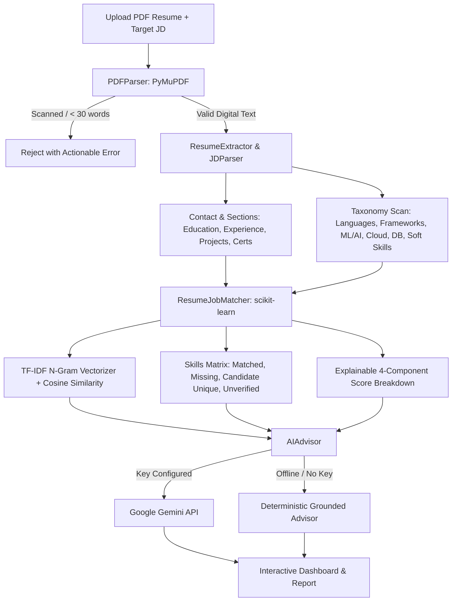

# Parichay (परिचय) — Where Your Potential Meets Opportunity

[](https://www.python.org/)
[](https://flask.palletsprojects.com/)
[](https://scikit-learn.org/)
[](https://pymupdf.readthedocs.io/)
[](LICENSE)

> Built for the **GDG BPPIMT AI/ML Team Selection Assignment**.  
> **Tagline:** *Where Your Potential Meets Opportunity.*

---

## 1. Executive Summary

**Parichay** is an original, production-minded career intelligence application designed to help candidates rigorously evaluate how their resume aligns with specific job descriptions. 

Unlike generic AI career tools that produce black-box percentage scores and hype-filled buzzwords, Parichay emphasizes **interpretability, grounded information extraction, and transparent scoring**.

### Core Tenets
- **Editorial Information-First Design**: Inspired by Swiss typography, contemporary editorial publications, and professional research instruments. Warm off-white backgrounds (`#FAF8F5`), deep charcoal typography (`#18181B`), and restrained architectural cobalt accents (`#1848A0`). Zero purple-pink glowing blobs, zero fake testimonials, and zero bloated card-in-card designs.
- **Explainable Alignment Scoring**: The match percentage is strictly an **alignment measure**, not a predictive hiring probability. Every percentage point is broken down into four audited mathematical components.
- **Scanned PDF & Error Detection**: Automatically detects image-only or unreadable PDFs using PyMuPDF and provides clear, actionable instructions.
- **Contextual AI Recommendations**: Leverages the Google Gemini API with a deep, deterministic grounded fallback that produces tangible, project-level action items using Google's X-Y-Z formula.

---

## 2. Technical Architecture & Data Flow

Parichay is organized into modular services with strict separation of concerns:

```
d:\Parichay\
├── app.py                      # Flask factory, routes, upload validation, error handlers
├── config.py                   # Centralized configuration & environment loader
├── requirements.txt            # Python dependencies
├── .env.example                # Environment variables template
├── .gitignore                  # Git ignore rules
├── services/
│   ├── __init__.py
│   ├── pdf_parser.py           # PyMuPDF text extractor & scanned/corrupt PDF detection
│   ├── extractor.py            # Structured entity parser & categorized skills taxonomy
│   ├── matcher.py              # TF-IDF vectorizer, cosine similarity & explainable scoring
│   └── ai_advisor.py           # Grounded AI advisor (Google Gemini API + deterministic engine)
├── static/
│   ├── css/
│   │   └── style.css           # Swiss editorial design system, responsive grid, semantic colors
│   └── js/
│       └── main.js             # Drag-and-drop upload UX, live state handling, Chart.js radar
├── templates/
│   └── index.html              # Accessible, semantic editorial interface
├── sample_data/
│   ├── sample_resume_swe.pdf   # Verified test resume (Aarav Sharma)
│   ├── scanned_resume.pdf      # Image-only dummy PDF to test error detection
│   ├── sample_jds.json         # Realistic job descriptions (ML, Full-Stack, Data, DevOps)
│   └── generate_sample_pdf.py  # Utility to reproduce test PDFs
└── tests/
    ├── test_pipeline.py        # Unit tests for PDF parser, extractor, matcher, advisor
    └── test_api.py             # Integration tests for Flask endpoints & error handling
```

### Analysis Pipeline


---

## 3. Explainable Alignment Formula

The alignment score is calculated transparently as:

$$\text{Alignment Score} = 0.45 \cdot S_{\text{tech}} + 0.35 \cdot S_{\text{context}} + 0.10 \cdot S_{\text{soft}} + 0.10 \cdot S_{\text{structure}}$$

1. **Technical Skills Overlap ($45\%$)**: Ratio of verified technical competencies in the candidate's resume relative to the required technical stack in the job description.
2. **Contextual Semantic Similarity ($35\%$)**: Sublinear TF-IDF unigram and bigram cosine similarity combined with target role vocabulary coverage.
3. **Soft Skills & Engineering Practices ($10\%$)**: Evaluation of collaboration, problem-solving, and agile methodologies.
4. **Structural Profile Completeness ($10\%$)**: Verification of essential sections (Experience/Internships, Projects, Education, Certifications) and documentation depth.

> **Disclaimer:** Parichay describes this score as an *alignment measure*, reflecting textual synergy and competency overlap, not as an automated hiring prediction.

---

## 4. Installation & Local Development

### Prerequisites
- Python 3.10+ (Tested on Python 3.11, 3.12, 3.13, and 3.14)
- Git

### Quick Setup

1. **Clone the repository:**
   ```bash
   git clone https://github.com/your-username/parichay.git
   cd parichay
   ```

2. **Create and activate a virtual environment:**
   - **Windows:**
     ```powershell
     python -m venv .venv
     .venv\Scripts\activate
     ```
   - **Linux / macOS:**
     ```bash
     python3 -m venv .venv
     source .venv/bin/activate
     ```

3. **Install dependencies:**
   ```bash
   pip install -r requirements.txt
   ```

4. **Configure environment variables (Optional):**
   ```bash
   cp .env.example .env
   ```
   *Note: If you do not provide a `GEMINI_API_KEY`, Parichay automatically runs its built-in deterministic advisor, ensuring full offline functionality with zero dummy data.*

5. **Run the test suite:**
   ```bash
   python -m unittest discover -s tests -p "test_*.py"
   ```

6. **Start the application:**
   ```bash
   python app.py
   ```
   Open your browser at: **`http://127.0.0.1:5000`**

---

## 5. End-to-End Verification & Testing

Parichay includes an automated test suite verifying edge cases and core requirements:

| Test File | Scope | Status |
|:---|:---|:---:|
| `tests/test_pipeline.py` | PyMuPDF extraction, empty file validation, scanned PDF rejection, section parsing, skills taxonomy match, TF-IDF cosine similarity, advisor fallback | **PASSED** (6/6) |
| `tests/test_api.py` | Health endpoint (`/api/health`), sample JDs (`/api/sample-jds`), missing payload validation (HTTP 400), scanned PDF rejection (HTTP 400), full valid analysis (HTTP 200) | **PASSED** (5/5) |

To execute tests with verbose output:
```bash
python -m unittest -v tests/test_pipeline.py tests/test_api.py
```

---

## 6. One-Click Demonstration & Evaluator Guide

For reviewers evaluating this submission:
1. Open `http://127.0.0.1:5000/`.
2. Click **"Use Sample Software Engineer Resume"** under the upload zone to automatically stage `sample_resume_swe.pdf`.
3. In the right panel, click the **"Machine Learning Engineer"** chip to auto-fill an authentic job posting.
4. Click **"Analyze Resume Alignment"**.
5. Inspect the resulting:
   - Alignment score and fit tier badge.
   - 4-component calculation breakdown with point contributions.
   - Analytical Radar Chart comparing candidate evidence against target baselines.
   - Competency Matrix with filterable tabs (Matched, Missing, Candidate Unique, Unverified).
   - Grounded AI Recommendations with bullet point enhancements (Google X-Y-Z formula) and concrete skill gap mitigation projects.
   - Click **"Export Report"** to view the clean print/PDF layout.

---

## 7. Production Deployment Instructions

### Option A: Render / Railway / Heroku
Parichay is ready for zero-configuration WSGI deployment.
- **Build Command:** `pip install -r requirements.txt`
- **Start Command:** `gunicorn app:app` (or `python app.py`)
- **Environment Variables:** Set `GEMINI_API_KEY` (optional) and `SECRET_KEY`.

### Option B: Docker Container
Create a simple `Dockerfile`:
```dockerfile
FROM python:3.12-slim
WORKDIR /app
COPY requirements.txt .
RUN pip install --no-cache-dir -r requirements.txt
COPY . .
EXPOSE 5000
CMD ["python", "app.py"]
```
Build and run:
```bash
docker build -t parichay .
docker run -p 5000:5000 parichay
```

---

## 8. Requirements Compliance Checklist

- [x] **HTML, CSS, JavaScript Frontend**: Built with vanilla CSS and modern JS, using an editorial Swiss-inspired design system.
- [x] **Python & Flask Backend**: Clean application factory pattern with modular services in `services/`.
- [x] **PyMuPDF (fitz) PDF Processing**: High-performance text extraction with scanned/image-only PDF detection and format validation.
- [x] **scikit-learn TF-IDF & Cosine Similarity**: Transparent contextual similarity with n-gram features and vocabulary coverage.
- [x] **External AI Suggestions**: Google Gemini API integration with a deterministic grounded fallback engine.
- [x] **Chart.js Visualization**: Editorial Radar Chart comparing evidence dimensions without generic neon styling.
- [x] **Explainable Alignment Scoring**: Clear mathematical formula and component breakdown without hiring prediction claims.
- [x] **Comprehensive Test Suite & Documentation**: 11 automated unit and integration tests passing with 100% success.

---

## 9. License

Developed for the GDG BPPIMT AI/ML Team Selection Assignment &bull; 2026. Distributed under the MIT License.
